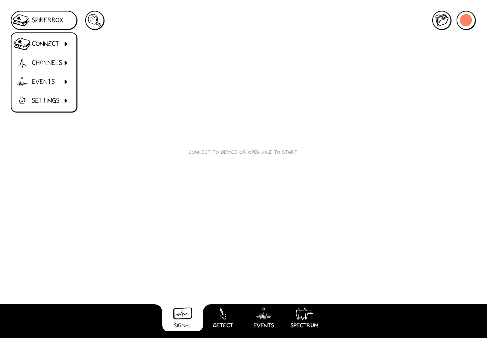

# Connect a SpikerBox

Set up the electrodes and power supply using your [SpikerBox's own guide](/#choose-your-device). Use a data-capable USB cable and any adapter required by your computer or mobile device. A charging-only cable can power a device without carrying its signal.

## In the app

1. Connect the SpikerBox and open Spike Recorder.
2. If the device has not connected automatically, open the **SpikerBox** menu at the upper left and choose **Connect**.
3. Select your device if a chooser appears. Allow the requested device access.
4. Open **Signal**. Check that the trace responds to your experiment.
5. Open **SpikerBox → Channels** to choose the channels you need before recording.

The available connection depends on your SpikerBox model and operating system. An adapter changes the plug; it does not by itself make an unsupported device connection work. Check the device guide if no device appears.

*Choose Connect from the SpikerBox menu to request device access. This is the actual web app before a device is connected.*

## Chromebook and the web app

Open [Spike Recorder in the browser](https://spikerecorder.backyardbrains.com/app/). For USB recording, use Chrome on a Chromebook or a desktop browser with Web Serial support, such as Chrome or Edge.

**The browser needs permission to use your SpikerBox before a live signal can appear.**

1. Plug in the SpikerBox with a USB data cable.
2. Choose **SpikerBox → Connect** in the app.
3. In the browser's device chooser, select the SpikerBox's port, then confirm access. The name may identify the USB serial device rather than your SpikerBox model.
4. Return to the app and check for a live trace.

If you cancel the chooser, use **Connect** again. If access was blocked, review the site's serial-device permissions in the browser's site settings. A school-managed Chromebook may have a device policy that requires your administrator to allow access.

USB serial access and microphone permission are different. This USB workflow needs permission for the connected device. Instructions about recording through a computer's microphone input belong to the [Classic guide](/software/spike-recorder/classic/connection-methods/).

## Phones and tablets

Use the native app and the connection supported by your SpikerBox. Accept an operating-system USB permission prompt if one appears. A browser on a phone or tablet may lack the device access needed for USB recording even when it can display the app.

Once connected, the recording controls follow the same workflow as on a computer. See [Files and sharing](../files-and-sharing.md) for the differences after you press Stop.

## Switch from a recording to a live device

Save any edits you want to keep, then choose **SpikerBox → Connect**. Connecting switches the signal source from the file to the device. Opening a file switches the source back and releases the live connection.

If the connection fails, start with [connection troubleshooting](../troubleshooting/index.md#no-spikerbox-or-no-live-signal).
