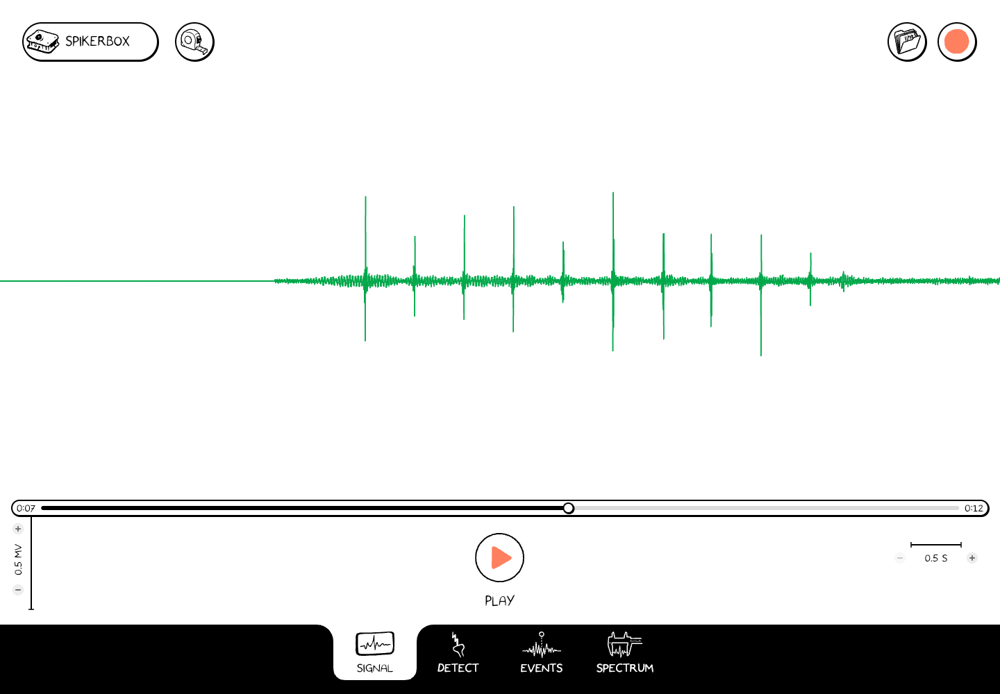
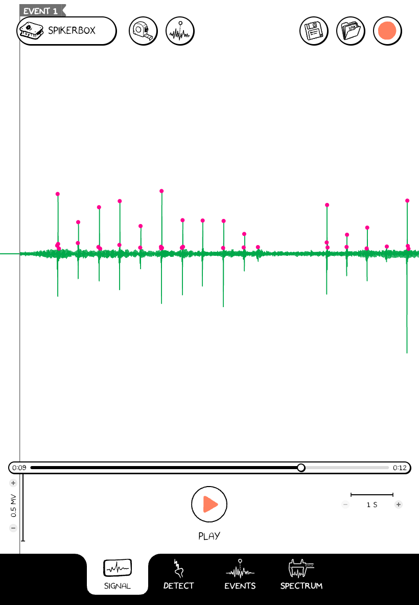

# Know the screen

Most of the screen is the waveform: time runs horizontally, and signal amplitude runs vertically. The controls stay around its edges so you can change views without losing your place.

*Signal view with a saved recording paused near 7 seconds. The screenshot shows a 0.5 mV amplitude scale and a 0.5 s time scale.*

## Main controls

| Control | What it does |
| --- | --- |
| **SpikerBox**, upper left | Opens the menu for **Connect**, **Channels**, **Events**, and **Settings**. |
| **Measure**, tape-measure icon | Turns interval measurement on or off in a supported view. In Signal, drag across the trace to measure a section. |
| **File**, folder at upper right | Opens the recording chooser. The chooser is supplied by the browser or desktop OS, or is the app's recordings list on a phone/tablet. |
| **Record / Stop**, upper right | Starts recording a connected SpikerBox; Stop ends the recording and starts saving it. |
| **Save**, disk beside File | Appears when an opened recording has unsaved edits, such as event marks. Saves those edits. |
| **Play / Pause**, bottom center | Plays or pauses an open recording. With a live device, pauses or resumes the live display/acquisition. It is unavailable while recording. |
| **Position slider**, above playback controls | Moves to another time in an opened recording. |
| **Amplitude and time scales** | Change how much signal height and time are visible. Read the displayed units when comparing traces. |

While recording, several tools and menus are hidden or unavailable. Finish with **Stop** before changing the recording setup or opening a file.

## Four workspaces

| Tab | Use it for |
| --- | --- |
| **Signal** | Watching the trace, playing a recording, and measuring a time interval. |
| **Detect** | Setting a threshold or amplitude band to select spikes. |
| **Events** | Comparing the average waveform around selected spikes or event marks. |
| **Spectrum** | Viewing how the signal's frequency content changes over time. |

The **Events tab** is the analysis workspace. **SpikerBox → Events** is the menu for adding and editing event labels.

## On a smaller screen

The app rearranges and compacts controls to fit the available space. The workflow and tab names remain the same. If a panel covers the trace, close that panel to return to the waveform.

*The same web app at a tablet-sized viewport; this is not a screenshot of the native iPad app.*
