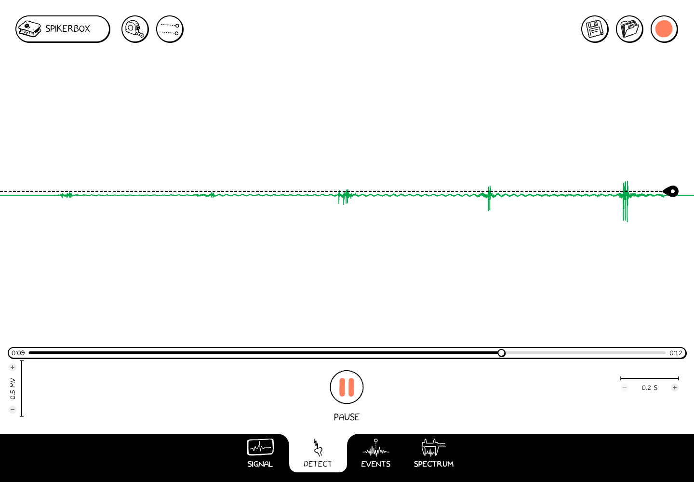

# Detect spikes

**Detect** helps you select spikes by their amplitude. Begin with a connected signal or an opened recording, and choose the channel you want to examine.

1. Select **Detect** at the bottom.
2. Locate the dashed threshold line and its handle at the right edge of the plot.
3. Drag the handle to a level that separates the spikes of interest from smaller fluctuations.
4. Play the recording or observe the live signal, and inspect which waveforms are selected.
5. Adjust the threshold while comparing selected spikes with the original trace.

*The dashed line is the threshold for the selected channel. This example shows a recording during playback.*

## Use two thresholds

The **Two thresholds** button appears in the top controls on Detect. It switches to an amplitude band with two boundaries. Drag the boundaries to select a range of spike amplitudes instead of using one threshold.

Each channel has its own threshold settings. Check the selected channel and its scale before making a comparison between channels.

## Inspect what was selected

Switch to [Events](./events.md#compare-waveforms-in-events) to inspect the average waveform for a selected spike train. A spike train is the set of spike times selected by your detection settings.

Threshold selection is a way to explore the recording. Noise or motion artifacts can also cross a threshold, so check the waveform and experimental context before interpreting a selected spike as neural activity.

When working on an opened recording, use the disk-shaped **Save** control if it appears to preserve your analysis changes. Use a new filename if you want to keep the original analysis unchanged.
