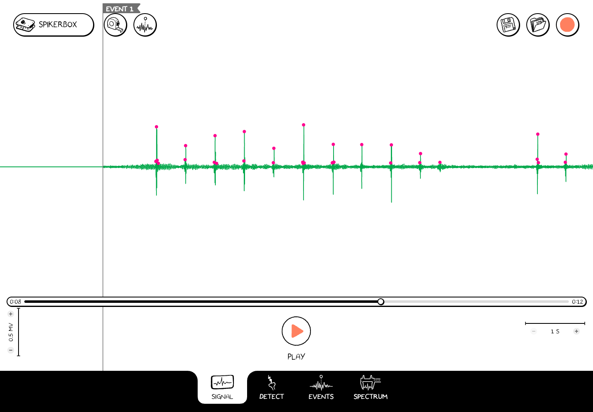
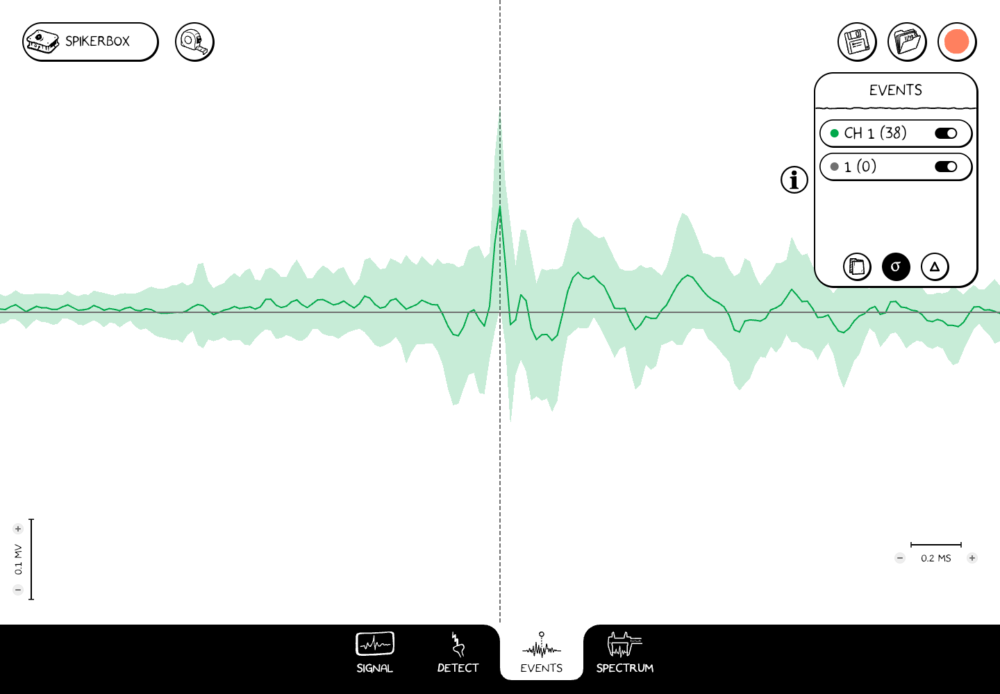

# Events and averages

Event marks identify moments such as a stimulus, a movement, or the start of a trial. They give you a reference time for comparing the signal before and after something happened.

## Add a mark

With a device connected or recording open, press a number key such as **1** to place that event at the current signal/playback time. In the sample below, pressing 1 added an **Event 1** marker.

For touch controls or named events, open **SpikerBox → Events**. Add or edit an event label there. Adding or editing a label makes the event-marking control available on Signal and Spectrum; use it to choose and place a mark. You can also configure labels before a recording.

The menu manages event labels. The **Events tab** at the bottom displays analysis.

*An event added to an opened recording. The Save disk shows that edits still need saving.*

## Keep your marks

For an active recording, marks within the recorded interval are included when you Stop and save. For edits to an opened recording, press the **Save** disk and finish the save step. Merely seeing a marker on screen does not mean it has been written to the file.

## Compare waveforms in Events

1. [Select spikes in Detect](./detect.md) or add event marks.
2. Open the **Events** tab.
3. Choose an available spike train or event entry from the list.
4. Inspect the average waveform around those times. The standard-deviation display shows how much the contributing waveforms vary.

*An average from selected CH 1 spikes in the sample recording. The counts and waveform depend on the recording and detection settings.*

An empty entry or a count of zero has no contributing waveforms to average. Check that the intended channel is enabled, that spikes or marks exist, and that you selected the correct entry.
