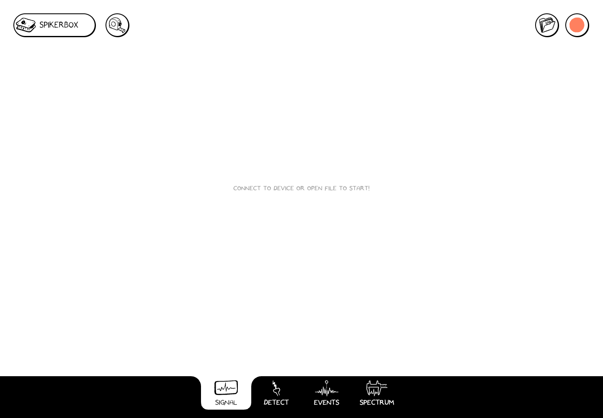

# Spike Recorder 4.0

Spike Recorder turns the signals from your SpikerBox into a moving graph. Use it to watch an experiment, record it, then reopen the recording to measure signals and explore spikes and frequency content.

This is the **Current** guide for the new app. Use **Classic** above for the older Spike Recorder. The main controls are shared across computers, phones, tablets, and the web; device permission prompts and file windows depend on your operating system.

## Make your first recording

1. **Open Spike Recorder.** Get the app or launch the browser version from [Spike Recorder](https://spikerecorder.backyardbrains.com/).
2. **Connect your SpikerBox.** Follow your [device's setup instructions](/#choose-your-device), connect its data cable, then use **SpikerBox → Connect** if it has not connected automatically. In a browser, select the device and allow access when prompted.
3. **Check the signal.** Choose **Signal** at the bottom. A moving trace shows incoming data. Open **SpikerBox → Channels** to check which channels are on.
4. **Press Record** at the upper right. It changes to **Stop**, and the recording clock runs.
5. **Press Stop** when you finish. Complete any save prompt and wait for saving to finish.
6. **Press File** (the folder) and open the saved recording. Use **Play/Pause** and the position slider to review it.

:::tip Watching and recording are different
A moving live trace does not mean a file is being recorded. Look for **Stop and the recording clock**. See [Record and save](./record-and-save.md) for the complete workflow.
:::

*Start screen in the web app. Connect a SpikerBox for live signals, or use File to explore an existing recording.*

## Choose your next step

- [Connect a SpikerBox](./connection-methods/index.md), including Chromebook USB permission.
- [Learn the controls](./controls.md) and the four workspaces.
- [Record and save](./record-and-save.md), then [open and review](./open-and-review.md).
- [Set up channels](./channels-and-settings.md), [detect spikes](./detect.md), [mark events](./events.md), or [explore Spectrum](./spectrum.md).
- [Find and share files](./files-and-sharing.md), or [solve a problem](./troubleshooting/index.md).

The screenshots in this guide show the actual 4.0 web app. Tablet-sized screenshots show the responsive web layout; your operating system's file picker and permission dialogs will look different.
