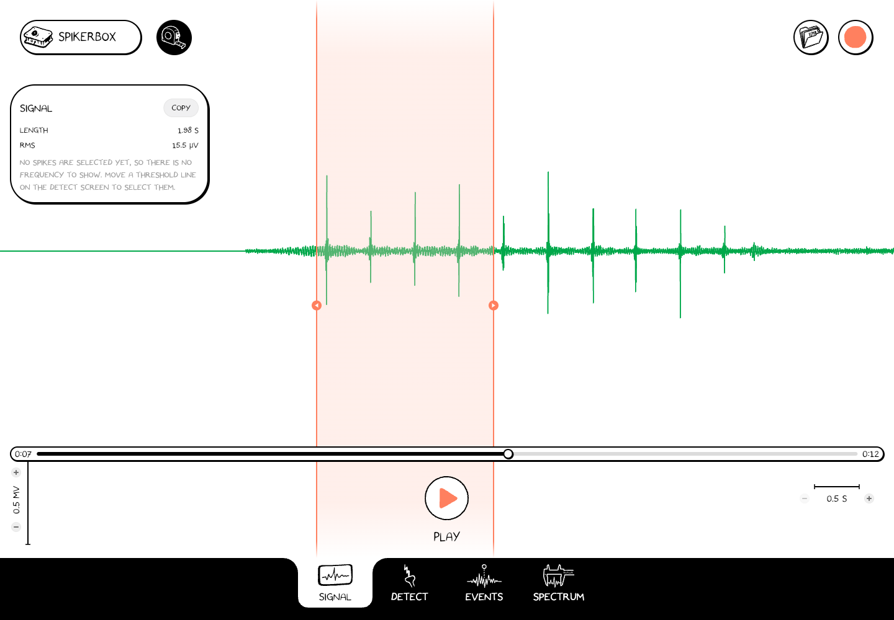

# Open and review a recording

You do not need a connected SpikerBox to explore a saved recording.

1. Press **File**, the folder at the upper right.
2. Select a recording in the system/browser chooser or the app's recordings list.
3. Use **Play/Pause** at the bottom to control playback.
4. Move the **position slider** to the part of the experiment you want to inspect.
5. Adjust the displayed time and amplitude scales to make the signal easier to see.

Opening a recording switches away from the live device. Canceling the file chooser leaves the current source in place. To return to live signals, save any edits and use **SpikerBox → Connect**.

## Measure an interval

1. In **Signal**, pause near the section of interest.
2. Press **Measure** (the tape-measure icon).
3. Drag across the waveform to select a time interval.
4. Read the measurement panel. **Length** is the selected duration. **RMS** summarizes signal amplitude over that interval; it is not the height of a single peak.
5. Use **Copy** to copy the displayed measurements, or turn Measure off to return to ordinary navigation.

*This sample's selected interval is 1.98 seconds with an RMS amplitude of 15.5 µV. Your values depend on the recording and selection.*

Read the units shown by the app. Calibration and the available channels depend on the source recording or device.

## Continue the analysis

- Use [Detect](./detect.md) to select spikes by amplitude.
- Add [event marks](./events.md) to identify stimuli or moments in the experiment.
- Use [Spectrum](./spectrum.md) to look at frequency content.

Changing the view does not make a new recording. If you add marks or other saved analysis changes, use the **Save** disk when it appears.
