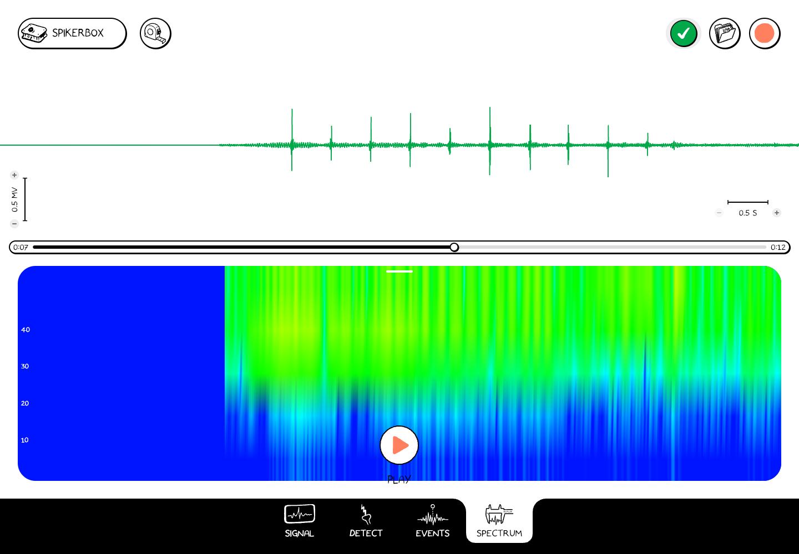

# Explore Spectrum

The **Spectrum** tab shows the waveform above a spectrogram. A spectrogram shows how the signal's frequency content changes with time. Color represents the strength of that frequency content.

1. Open a recording or connect a SpikerBox.
2. Select **Spectrum** at the bottom.
3. If more than one channel is available, choose the channel with the channel control.
4. Play the recording or watch the live signal. Compare a change in the waveform with the frequency pattern below it.
5. Pause playback to inspect a section, or move to another time in the recording.

*The sample recording in Spectrum. The upper waveform and lower spectrogram are two views of the selected signal.*

Read the axes and scales when comparing intervals. A persistent frequency band may come from the biological signal, electrical interference, or the recording setup; use the experiment and device setup to interpret it.

To measure a time interval on the waveform, return to [Signal and Measure](./open-and-review.md#measure-an-interval).
